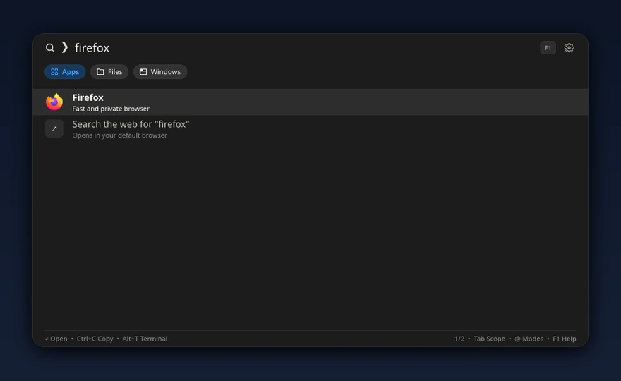
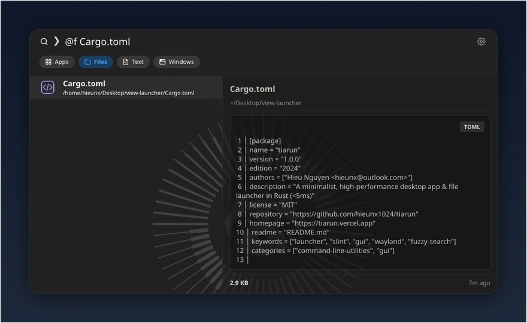

<p align="center">
  
</p>

# TiaRun

TiaRun is a keyboard-driven desktop launcher for Windows and Linux. Open an app, find a file, switch windows, or copy the result of a calculation from the same search bar. Search also matches Vietnamese names without accents: `ke hoach` finds `Kế hoạch dự án`.

[Download from GitHub Releases](https://github.com/hieunx1024/tiarun/releases/latest) · [Report a bug](https://github.com/hieunx1024/tiarun/issues)



## Install

Get the package for your system from [GitHub Releases](https://github.com/hieunx1024/tiarun/releases/latest). The release workflow builds x86-64 packages.

| System | Package | How to start |
| --- | --- | --- |
| Windows | Installer (`.exe`) | Run the installer, then open TiaRun from the Start menu. |
| Windows | Portable archive (`.zip`) | Extract the archive and run the executable inside. |
| Debian or Ubuntu | Debian package (`.deb`) | Open the package with your software installer, or run `sudo apt install ./<package>.deb` with the downloaded filename. |
| Linux | Archive (`.tar.gz`) | Extract the archive and run the included executable from your desktop session. |

Open TiaRun once, then use **Ctrl + Alt + Space** to show or hide it. If the shortcut is unavailable on your Linux desktop, bind it to `tiarun` in your desktop's keyboard settings. For an extracted archive, use the full path to the executable.

## Search and shortcuts

| Type | What it does |
| --- | --- |
| `firefox` | Find and launch an installed app. |
| `@f ke hoach` | Find files and folders by name across indexed locations. |
| `25 km to miles` | Convert units. Enter expressions like `500 * 12` to calculate. Press **Enter** to copy the result. |
| `@w` | Search open windows and switch to the selected one. On Linux, requires Hyprland, Sway, or windows accessible through `wmctrl`. |
| `@c` | Find previously copied text and copy it again. |
| `@sys` | Find system actions such as lock, sleep, and restart. Availability depends on the platform. |

Use **↑** and **↓** to select a result, **Enter** to activate it, and **Esc** to close the launcher. Open preferences with **Ctrl + ,** to adjust appearance, search settings, and startup behavior.

### In development

The source build adds `@t` for searching inside text files and Word `.docx` documents, and a preview pane for supported files. By default, content search looks in Documents, Desktop, and Downloads when those folders exist. Set `[[search.paths]]` to choose other locations.

In this v1.0 release, **Tab** and **Shift + Tab** cycle between Apps, Files, Text, and Windows. Press **→** to browse into a selected folder.



## Configuration

Open preferences with **Ctrl + ,**. To set search locations and exclusions directly, edit `config.toml` in the TiaRun configuration directory.

| System | Path |
| --- | --- |
| Linux | `$XDG_CONFIG_HOME/tiarun/config.toml`, or `~/.config/tiarun/config.toml` by default |
| Windows | `%APPDATA%\tiarun\config.toml` |

For example, these settings index up to three levels under `~/Projects` for file-name search.

```toml
[search]
enable_path_matching = true

[[search.paths]]
path = "~/Projects"
depth = 3
```

TiaRun searches apps and files on your device. Selecting a web search result opens the query in your browser. Currency conversion attempts to refresh exchange rates in the background when the cache is missing or older than 24 hours, and can use cached or built-in rates offline.

## Build from source

Install the stable Rust toolchain. On Debian or Ubuntu, install the Linux build dependencies used by the release workflow.

```sh
sudo apt install build-essential pkg-config libxkbcommon-dev libxkbcommon-x11-dev \
  libfontconfig1-dev libwayland-dev libegl1-mesa-dev libgl1-mesa-dev libx11-dev libx11-xcb-dev
```

```sh
git clone https://github.com/hieunx1024/tiarun.git
cd tiarun
cargo build --release --locked
```

The binary is `target/release/tiarun` on Linux and `target\release\tiarun.exe` on Windows. To build an Inno Setup installer, build the release binary first, then compile [setup.iss](installer/windows/setup.iss).

### Tests

On Linux, install `xvfb` and run `xvfb-run cargo test --verbose`. On Windows, run `cargo test --verbose`. The UI tests create a window and need a display on Linux.

## License

MIT, as declared in [Cargo.toml](Cargo.toml).
